<h1 align="center">Roundhouse</h1>

<p align="center">
  
</p>

<p align="center">
  <b>One lamp in your bar. Click it and the whole machine slides out of that icon.</b><br>
  CPU, GPU and memory pressure, every disk and network share, memory by app,<br>
  and your build queue when Switchyard is running. Styled from your own waybar.
</p>

<p align="center">
  <a href="https://github.com/NathanielInman/roundhouse/actions/workflows/ci.yml"></a>
  
  
  <a href="LICENSE"></a>
</p>

A roundhouse is the building where a railroad brings locomotives in to inspect
and service them. [Switchyard](https://github.com/NathanielInman/switchyard)
dispatches your work. Roundhouse tells you whether the engine is fit to run it.

## Why

My waybar had a `group/details` drawer that slid open into network traffic,
temperature, three disk modules, memory, CPU and a public IP. Every new drive
added another module, two drives never made it in at all, and none of it
remembered anything or told me which number mattered. That drawer is what
Roundhouse replaces.

- **One lamp.** The bar shows a single dot. It turns amber or red only when
  something needs you: a filesystem filling up, a drive or CPU running hot,
  memory pressure. The tooltip says why, and a click shows the rest. A
  two-second spike does not change it, a CPU boosting to its limit is not an
  alarm until it sits there, and a value hovering at a line does not make it
  flicker.
- **Temperatures against their limits.** What counts as hot depends on the
  part, so Roundhouse asks each one: the drive's own warning temperature,
  the CPU's TjMax, the point where the GPU slows down. Every reading shows
  next to that limit (`58 / 95°C`), green while it is well under.
- **It opens from the icon you clicked.** The drawer springs out of the bar on
  any edge, on whichever monitor you clicked. The anchoring code is
  Switchyard's.
- **It looks like your bar.** Font, background, text and border colors come
  from waybar's `style.css`. Edit the bar's stylesheet and the drawer follows
  without a restart.
- **No config to start.** Disks, shares, GPUs and sensors are found on their
  own. An empty config file is a working setup.

## What's in the drawer

| Tab | What it answers |
|---|---|
| **Machine** | Why is it slow right now? CPU and GPU with sparklines, memory, pressure stall (PSI), which says whether anything is actually waiting, and network throughput across every real interface (renamed NICs need no config). Audio: PipeWire's quantum, latency, DSP load and dropouts per minute, each sound card that is playing or recording, and plugged-in MIDI devices. Memory by app, counted from each app's cgroup, so 40 Chrome processes read as one line. Scopes started with `systemd-run` or `lowprio` show their memory cap. |
| **Network** | Is it the cable, the LAN or the internet? The way out hop by hop: the default route, whether the router answers and how fast, and (opt-in) whether the internet and DNS answer, with the lamp naming the first hop that fails. Each interface with its negotiated speed, how full it is, Wi-Fi signal, bad frames and link drops per minute. A link that renegotiates below its best speed (a bad cable) is a heads-up. |
| **Storage** | Where did my space go? Each physical disk with its model and NVMe temperature, and the filesystems on it. btrfs subvolumes and bind mounts fold into one line. Network shares are sized on a helper thread with a deadline, so a NAS that went away never stalls anything, and automount points that nobody has opened are listed without being woken. |
| **Switchyard ↗** | Not a page: a link to the Switchyard board, shown only while Switchyard runs. Its dot says what Switchyard is doing (blue while it builds, red when something failed). A click or its number key closes the drawer and opens the board from the same icon. |

`rh doctor --audio` says whether the machine is fit to record: the CPU
governor and EPP, whether PipeWire's data thread runs realtime, your realtime
limit, kernel preemption and threaded IRQs, and USB autosuspend on each
audio interface, each with its fix.

`rh status` prints the same thing in a terminal, and `rh status --json` gives
it to scripts and agents.

## Siblings

Switchyard and Roundhouse know about each other and need nothing from each
other. Each one finds the other's socket in `$XDG_RUNTIME_DIR`; if it is not
there, the features that depend on it stay hidden. Nothing errors, nothing
waits.

- With Switchyard running, each panel links to the other from the end of its
  tab row (`● Switchyard ↗` here, `● Roundhouse ↗` on the board), and a
  click swaps one for the other from the same icon. While a heavy build runs
  or waits, the Machine tab and the bar tooltip say so in one line
  ("Switchyard is building storefront · 1 queued").
- With Roundhouse running, Switchyard holds the next heavy build while
  memory is stalling or a filesystem is past 95%, and the waiting tile says
  why. It starts on its own once that clears. A hot CPU does not hold builds:
  the build is what heats it.
- `rh session on` starts a recording session: Switchyard starts no heavy
  build until `rh session off` (or a click on the session line in the
  drawer), and the lamp keeps its color. A heavy build in the middle of a take
  is what makes audio stutter, even at nice 19.
- The sibling contract is plain JSON lines over each daemon's socket, read
  loosely, so the two can be upgraded separately. It is written down in
  [docs/design.md](docs/design.md#siblings).

## Install

Roundhouse is at 0.1. It runs on Linux with Wayland, and Hyprland gets the
exact-icon anchoring. Packages come later; for now, build from source:

```sh
# Arch: the drawer's libraries
sudo pacman -S --needed gtk4 gtk4-layer-shell

git clone https://github.com/NathanielInman/roundhouse
cd roundhouse
cargo build --release
install -Dm755 target/release/rh target/release/rh-board -t ~/.local/bin/
rh doctor
```

NVIDIA GPUs are read through NVML, which ships with the driver. Without it the
GPU tile shows AMD cards or hides.

## Put it in your bar

```jsonc
"custom/roundhouse": {
  "exec": "~/.local/bin/rh bar",
  "return-type": "json",
  "on-click": "~/.local/bin/rh toggle",
  "on-click-right": "~/.local/bin/rh toggle --tab storage"
}
```

Use full paths: a waybar started by systemd usually does not have
`~/.local/bin` on its `PATH`. `rh bar` starts the daemon the first time it
runs, and the daemon starts the drawer the first time you click.

The module's class follows the lamp (`calm`, `heads-up`, `act`, `offline`), so
the bar can color it:

```css
#custom-roundhouse.calm { color: #a3be8c; }
#custom-roundhouse.heads-up { color: #ebcb8b; }
#custom-roundhouse.act { color: #bf616a; }
```

In the drawer, <kbd>1</kbd>-<kbd>3</kbd> or <kbd>Tab</kbd> switch tabs,
<kbd>4</kbd> opens the Switchyard board while it runs, and <kbd>Esc</kbd> or
a click outside closes it.

## Config

Everything is optional. `~/.config/roundhouse/config.toml`:

```toml
[bar]
icon = "\U000F0765"   # the dot (Nerd Font md-circle); any glyph works
pin = "none"          # a number beside the dot: cpu.temp, cpu, memory, gpu.temp, gpu or none
namespace = "waybar"  # the bar's layer-shell namespace

[theme]
from = "waybar"       # or "none" for the built-in theme
# accent = "#88c0d0"
# font = "JetBrains Mono"

[drawer]
width = 460
tabs = ["machine", "storage", "network", "switchyard"]  # switchyard is the link to its board

[storage]
hide = ["/boot"]      # mount points to leave out

[lamp]
disk_warn = 85        # percent full
disk_act = 95
# Temperatures follow each part's own limit: heads-up 10°C under it, act at
# it. Set a key only to override that.
# cpu_temp_act = 90   # °C
fan_loud_rpm = 1600   # while recording, a fan this fast is a heads-up
fan_loud_pct = 60     # the same for a GPU fan, in percent
attack = 10           # seconds a temperature stays high before the lamp rises
sustain = 30          # seconds at its limit before act (CPUs boost to it)
release = 30          # seconds clear before the lamp falls

[network]
public_ip = false     # true asks ifconfig.co once a minute while the drawer is open
units = "bytes"       # or "bits": rates in Mb/s, like link speeds
internet_check = false  # true pings probe_host and looks up probe_name
probe_host = "1.1.1.1"
probe_name = "example.com"

[siblings]
switchyard = true

[session]
auto = false          # a recording app starts a recording session
cards = ["Yeti X"]    # only these cards start one (empty: any, webcams too)
```

A typo in the config falls back to the defaults and the drawer says what is
wrong at the top. `~/.config/roundhouse/style.css` overrides any part of the
look; redefining one of the `@define-color rh_*` tokens in
[style.css](crates/rh-board/src/style.css) recolors everything that uses it.

## Cost

The daemon reads `/proc`, `/sys` and NVML directly and never starts a
subprocess. With the drawer closed it samples every 5 seconds and only what
the lamp needs; storage refreshes every 30 seconds. With the drawer open it
samples every second and adds memory by app.

## What's next

1. **Arch tab:** is it safe to update today? Unread Arch news that needs
   manual steps, pending repo and AUR updates, `.pacnew` files, orphans,
   failed units, and "reboot needed" when the running kernel no longer
   matches the installed one.
2. **Timeline:** what happened while I was away? OOM kills, thermal spikes,
   shares dropping and updates, folded into episodes the way Switchyard's
   History is.
3. **Ports and Dev:** which process holds `:5173` and which repo started it;
   repos with unpushed work; containers.
4. **Script widgets:** any waybar custom-module script as a widget, unchanged.
5. **macOS and Windows** through a tray app, as Switchyard does.

## Development

```sh
cargo test --workspace
# A dev daemon that leaves an installed one alone:
export ROUNDHOUSE_RUNTIME_DIR=/tmp/rh-dev/run ROUNDHOUSE_STATE_DIR=/tmp/rh-dev/state
cargo run -p rh -- daemon &
cargo build -p rh-board && cargo run -p rh -- toggle
```

See [AGENTS.md](AGENTS.md) for the crate layout and [docs/design.md](docs/design.md)
for how it works.

## License

MIT
