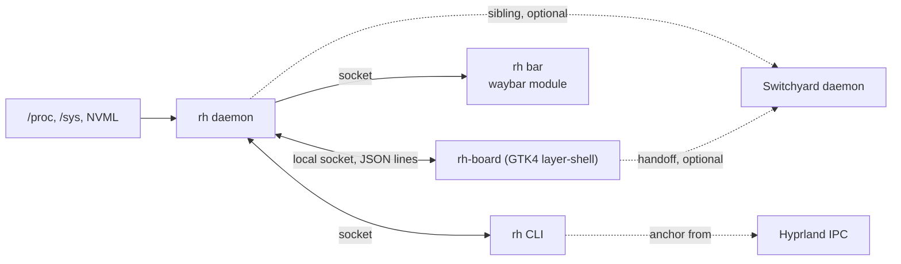

# Roundhouse design

Roundhouse is a system drawer for a Wayland desktop. The bar shows one lamp;
clicking it opens a panel that springs out of that icon and shows what the
machine is doing. This document is the reference for how it works and why.
The README is the tour; this is the spec.

## Goals

1. **One lamp.** The bar module is a single icon and an optional pinned
   number. Its color says whether anything needs you.
2. **Answers, not numbers.** Each tab answers one question ("why is it
   slow?", "where did my space go?"). Raw counters are there to back the
   answer up.
3. **Zero setup.** Disks, shares, sensors and GPUs are discovered. The theme
   comes from the bar.
4. **Cheap when closed.** The daemon never starts subprocesses and samples
   only the lamp's inputs while the drawer is hidden. It talks to the
   internet only when asked to (`network.public_ip`).
5. **Siblings, not dependencies.** Switchyard and Roundhouse each unlock
   features in the other when both run, and neither needs the other.

## Non-goals

- **Not a bar.** Roundhouse is one module in the bar you already have. It
  never draws a bar of its own and never owns more than one icon.
- **Not a process manager.** It shows memory by app and will offer a few
  actions; btop stays the tool for digging.
- **Not a package manager.** The planned Arch tab tells you what an update
  needs and hands you the command. It never runs pacman.

## Architecture



| Crate | Role |
|---|---|
| `bar-anchor` | Hyprland anchoring and panel placement. No GTK. Started as Switchyard's code and keeps its wire format, so the two can share it. |
| `rh-core` | Collectors, the snapshot model, lamp rules, config, the socket protocol, the waybar reader and the Switchyard client. No UI. |
| `rh` | The `rh` binary: daemon, CLI and waybar module. |
| `rh-board` | The Linux drawer: GTK4 on `gtk4-layer-shell`, overlay layer, keyboard exclusive while open. |

## Paths

| What | Where | Override |
|---|---|---|
| Config | `~/.config/roundhouse/config.toml` | `ROUNDHOUSE_CONFIG_DIR` |
| User stylesheet | `~/.config/roundhouse/style.css` | `ROUNDHOUSE_CONFIG_DIR` |
| Logs | `~/.local/state/roundhouse/` | `ROUNDHOUSE_STATE_DIR` |
| Socket | `$XDG_RUNTIME_DIR/roundhouse/rh.sock` | `ROUNDHOUSE_RUNTIME_DIR` |

The runtime directory is mode 0700 and the socket 0600.

## Sampling

The daemon samples on a timer: every second while the drawer reports it is
visible, every five seconds otherwise. A visibility change wakes the sampler
at once, so the drawer never opens on old data for long.

| Data | Source | When |
|---|---|---|
| CPU usage | `/proc/stat` deltas | every sample |
| CPU model, clock | `/proc/cpuinfo` | first sample, then while open |
| Temperatures | `/sys/class/hwmon`: `k10temp`/`zenpower` Tctl, `coretemp` package, `nvme`/`drivetemp` Composite mapped to block devices, `amdgpu` edge mapped to PCI devices; each with its limit (see the lamp) | every sample |
| Memory, swap | `/proc/meminfo` | every sample |
| Pressure | `/proc/pressure/{cpu,memory,io}` | every sample |
| NVIDIA | NVML, loaded at runtime once | every sample |
| AMD | `/sys/class/drm/card*/device` (`gpu_busy_percent`, `mem_info_vram_*`); names from `pci.ids` | every sample |
| Network | `/sys/class/net/*/statistics` for interfaces with a `device` link (no loopback, bridges or veths) | every sample |
| Public IP | one plain HTTP `GET /ip` to ifconfig.co on a helper thread, opt-in with `network.public_ip` | while open, at most once a minute |
| Storage | `/proc/self/mountinfo` and `statvfs` | while open, else every 30 s |
| Memory by app | `/proc/*/cgroup` and cgroup v2 files | while open only |
| Switchyard | its socket | every 2 s open, 15 s closed |

Sparklines keep the last 60 samples.

### Storage rules

- Real filesystems only (ext4, btrfs, xfs, f2fs, vfat, exfat, ntfs, zfs,
  bcachefs and friends) plus network ones (cifs, nfs, sshfs, rclone, 9p).
  Anything under `/proc`, `/sys`, `/dev`, `/run/user`, container storage and
  snaps is skipped.
- Mounts group by source device, so btrfs subvolumes and bind mounts are one
  filesystem. The main mount is `/`, else a mount that shows the
  filesystem's own root (`/scratch`, not its `/tmp` bind), else the shortest
  path.
- Filesystems group into their physical disk through device-mapper slaves and
  partition parents. The disk's model comes from `device/model`.
- Network filesystems are sized on a helper thread with a 300 ms deadline. A
  share that keeps the thread busy past two seconds is marked "not
  answering" and keeps its last known size. It never counts toward the lamp.
- An `autofs` mount point with nothing mounted on it is listed as "on
  demand" and is never touched.

### Memory by app

A process's cgroup decides how it is counted:

- `app-*.scope` or `app-*.service` (apps started by the desktop or uwsm): the
  cgroup's `memory.current` minus `inactive_file`. The name comes from the
  unit: `app-com.google.Chrome-910.scope` is "Chrome".
- `run-*.scope` (from `systemd-run`, which `lowprio` uses): the same, plus
  `memory.max` as the cap.
- Other `*.service` cgroups: the same, named after the service.
- Anything else (the compositor's session scope): RSS per process name.

Names merge case-insensitively, so Chrome's scope and stray `chrome`
processes in the session scope are one line.

## The lamp

`rh_core::lamp::evaluate` turns a snapshot into a level and a list of
reasons, most urgent first. Each reason names the tab that explains it, and
the drawer shows reasons as links to that tab.

| Rule | Heads-up | Act |
|---|---|---|
| Filesystem use | `disk_warn` (85%) | `disk_act` (95%) |
| Drive temperature | `drive_temp_warn` (limit - 10°C) | `drive_temp_act` (limit) |
| CPU temperature | `cpu_temp_warn` (limit - 10°C) | `cpu_temp_act` (limit) |
| GPU temperature | `gpu_temp_warn` (limit - 10°C) | `gpu_temp_act` (limit) |
| Memory pressure | PSI `some` avg60 at `mem_pressure_warn` (10) | PSI `full` avg10 at `mem_pressure_act` (10) |
| Free memory | | under `mem_free_act` (5%) |

Read-only filesystems, stale shares and automount points never count.

### Temperature limits

A safe temperature depends on the part: a Ryzen 9000 boosts until 95°C by
design, a Samsung 990 PRO warns at 82°C and a Sabrent at 75°C. So each
sensor's thresholds come from the point where that part protects itself
(throttles), as the hardware reports it:

| Sensor | Limit |
|---|---|
| NVMe | `temp1_max` on the Composite sensor (WCTEMP), else `temp1_crit` |
| SATA (`drivetemp`) | `temp1_max`, else `temp1_crit` |
| Intel (`coretemp`) | the package sensor's `crit` (TjMax) |
| AMD CPU (`k10temp`, which reports none) | AMD's TjMax by model: 89°C for the Ryzen 7000 X3D parts, 90°C for the 5800X3D family and the 5700X to 5950X; otherwise the 95°C fallback |
| NVIDIA | NVML's slowdown temperature |
| AMD GPU | the edge sensor's `crit` |

Heads-up is 10°C under the limit and act is the limit. A value outside
40-150°C is not a limit (drives report 65261°C on their extra sensors). A
part that reports nothing gets the old fixed thresholds: CPU 85/95, GPU
83/90, drive 65/75. A `[lamp]` key the user sets wins over all of this.

Every client shows a temperature against its act line ("58 / 95°C"), and a
lamp reason names the limit ("CPU is at 87°C (limit 95°C)"), so the number
answers whether it is fine without a lookup.

## Anchoring

Waybar does not publish module geometry, so `rh toggle` asks the compositor
while the cursor is still on the icon. Over Hyprland's IPC socket (no
`hyprctl` processes) it reads the cursor position, the monitor under it and
its reserved edges, and the bar's layer surface (namespace `waybar` by
default, `bar.namespace` in the config) to tell which edge the bar is on. The
result is an `Anchor`, sent with the toggle request.

The drawer covers the monitor with a transparent layer surface and places
the panel next to the bar's edge, centered on the click and clamped to the
screen (`bar_anchor::place`). The open spring scales from the click point.
Tiles follow with a stagger. Clicking outside the panel closes it. Without
Hyprland, or with `--center`, the panel opens centered.

## Theme

With `theme.from = "waybar"` the drawer reads waybar's `style.css`: the first
font family on `*` or `window#waybar`, the background and text color of
`window#waybar`, the first border color on a module rule, the background of
the first `:hover` rule, and every `@define-color` (an `accent` or `frost`
color becomes the drawer's accent). From those it derives the panel, dim
text, tile and border tokens. Layers, lowest first: built-in
`style.css`, the bar-derived tokens, the user's `~/.config/roundhouse/style.css`.
The drawer watches all three files and the config and restyles on change.

## Siblings

Switchyard and Roundhouse are separate products that know about each other.
The rules:

1. **Neither requires the other.** Every sibling feature is hidden when the
   sibling is absent. No error, no log line, no delay longer than the
   300 ms connect deadline.
2. **Discovery is the socket.** A sibling is present when its socket exists
   and answers. Switchyard's is `$SWITCHYARD_RUNTIME_DIR/yard.sock`, else
   `$XDG_RUNTIME_DIR/switchyard/yard.sock`. Roundhouse's is
   `$ROUNDHOUSE_RUNTIME_DIR/rh.sock`, else
   `$XDG_RUNTIME_DIR/roundhouse/rh.sock`.
3. **No shared crates on the wire.** Each side reads the other's JSON loosely
   (unknown fields ignored, missing fields defaulted), so they can be
   upgraded in any order. `bar-anchor` may be shared as a library, but the
   `Anchor` JSON is the contract.
4. **Handoff keeps the anchor.** When one opens the other, it sends the same
   `Anchor` it opened with, so the second panel grows out of the same icon.
5. **One panel at a time.** Whichever panel opens sends `{"cmd":"hide"}` to
   the other, so clicking the other icon in the bar (or the handoff button)
   never leaves both open.

What Roundhouse uses from Switchyard today:

| Request | Used for |
|---|---|
| `{"cmd":"snapshot"}` | The Switchyard tab: `aggregate.phase`, `aggregate.building`, `aggregate.running`, `aggregate.failed`, `mainline.current`, `mainline.queue`, `mainline.waiting_memory`, `tasks[].id` and `tasks[].label`. |
| `{"cmd":"show","anchor":{...}}` | The handoff button. |

What Switchyard uses from Roundhouse:

| Request | Used for |
|---|---|
| `{"cmd":"snapshot"}` on `rh.sock` | `lamp.level` and `lamp.reasons[].level`/`text`. While the lamp is at `act`, Switchyard holds the next heavy build with the reason as its message and starts it on the first calm answer (`mainline.respect_roundhouse` in Switchyard's config). |

Not used yet: `{"cmd":"show","anchor":{...}}` for a handoff from
Switchyard's board to this drawer.

The `lamp` shape (`level`, and `reasons` with `level`, `text` and `tab`) is
part of the sibling contract: change it only by adding fields.

## Protocol

Newline-delimited JSON on the socket, one request per line, one reply per
request. Shapes follow Switchyard's.

```json
{"cmd":"ping"}
{"cmd":"snapshot"}
{"cmd":"toggle","anchor":{"monitor":"DP-2","edge":"bottom","x":2310,"y":1428,"width":2560,"height":1440,"reserved":[0,0,0,24],"center":false},"tab":"storage"}
{"cmd":"show","anchor":null}
{"cmd":"hide"}
{"cmd":"board_visible","visible":true}
{"cmd":"subscribe","kind":"board"}
{"cmd":"subscribe","kind":"bar"}
```

Replies are `{"ok":true}` with optional `snapshot`, `version` or `error`.

A `board` subscription receives `{"event":"snapshot","snapshot":{...}}` on
every sample, plus `{"event":"show",...}`, `{"event":"toggle",...}` and
`{"event":"hide"}`. A `bar` subscription receives waybar JSON lines, already
formatted, only when they change. When a toggle arrives and no drawer is
subscribed, the daemon starts `rh-board` (next to `rh`, else on `PATH`) and
holds the show until it subscribes.

## Keyboard

| Key | Action |
|---|---|
| <kbd>1</kbd>-<kbd>9</kbd> | Tab by position |
| <kbd>Tab</kbd>, <kbd>→</kbd>, <kbd>l</kbd> | Next tab |
| <kbd>Shift</kbd>+<kbd>Tab</kbd>, <kbd>←</kbd>, <kbd>h</kbd> | Previous tab |
| <kbd>Esc</kbd> | Close |
