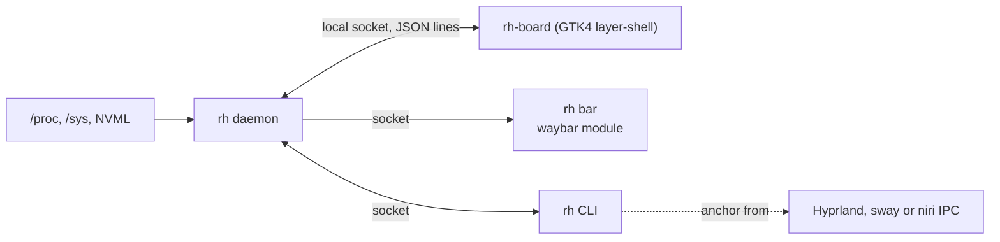

# Roundhouse design

Roundhouse is a system drawer for a Wayland desktop. The bar shows one lamp;
clicking it opens a panel that springs out of that icon and shows what the
machine is doing. This document is the reference for how it works and why.
The README is the tour; this is the spec.

## Goals

1. **One lamp.** The bar module is a single dot (and a pinned number only
   if you ask for one). Its color says whether anything needs you; the
   tooltip and the drawer say why. `bar.icon_heads_up`, `icon_act`,
   `icon_offline` and `icon_session` give each state its own glyph, so the
   lamp also reads without color.
2. **Answers, not numbers.** Each tab answers one question ("why is it
   slow?", "where did my space go?"). Raw counters are there to back the
   answer up.
3. **Zero setup.** Disks, shares, sensors and GPUs are discovered. The theme
   comes from the bar.
4. **Cheap when closed.** The daemon never starts subprocesses and samples
   only the lamp's inputs while the drawer is hidden. It talks to the
   internet only when asked to (`network.public_ip`,
   `network.internet_check`).

## Non-goals

- **Not a bar.** Roundhouse is one module in the bar you already have. It
  never draws a bar of its own and never owns more than one icon.
- **Not a process manager.** It shows memory by app and will offer a few
  actions; btop stays the tool for digging.
- **Not a package manager.** The planned Arch tab tells you what an update
  needs and hands you the command. It never runs pacman.

## Architecture



| Crate | Role |
|---|---|
| `bar-anchor` | Anchoring (Hyprland, sway, niri) and panel placement. No GTK. |
| `rh-core` | Collectors, the snapshot model, lamp rules, config, the socket protocol and the waybar reader. No UI. |
| `rh` | The `rh` binary: daemon, CLI and waybar module. |
| `rh-board` | The Linux drawer: GTK4 on `gtk4-layer-shell`, overlay layer, keyboard exclusive while open. |

## Paths

| What | Where | Override |
|---|---|---|
| Config | `~/.config/roundhouse/config.toml` | `ROUNDHOUSE_CONFIG_DIR` |
| User stylesheet | `~/.config/roundhouse/style.css` | `ROUNDHOUSE_CONFIG_DIR` |
| Logs | `~/.local/state/roundhouse/` | `ROUNDHOUSE_STATE_DIR` |
| Socket | `$XDG_RUNTIME_DIR/roundhouse/rh.sock` | `ROUNDHOUSE_RUNTIME_DIR` |
| Daemon lock | `$XDG_RUNTIME_DIR/roundhouse/daemon.lock` | `ROUNDHOUSE_RUNTIME_DIR` |
| Lamp history | `~/.local/state/roundhouse/history.jsonl` | `ROUNDHOUSE_STATE_DIR` |
| Recording session | `~/.local/state/roundhouse/session.json` | `ROUNDHOUSE_STATE_DIR` |
| Drawer binary | `rh-board` next to `rh`, else on `PATH` | `ROUNDHOUSE_BOARD` |

The runtime directory is mode 0700 and the socket 0600. The daemon holds
`daemon.lock` (flock) while it runs, so two started at once (both bar modules
after an upgrade) cannot both bind the socket: the second exits.

## Sampling

The daemon samples on a timer: every second while the drawer reports it is
visible, every five seconds otherwise. A visibility change wakes the sampler
at once, so the drawer never opens on old data for long.

| Data | Source | When |
|---|---|---|
| CPU usage | `/proc/stat` deltas | every sample |
| CPU model, clock | `/proc/cpuinfo` | first sample, then while open |
| Temperatures | `/sys/class/hwmon`: `k10temp`/`zenpower` Tctl, `coretemp` package, `nvme`/`drivetemp` Composite mapped to block devices, `amdgpu` edge mapped to PCI devices; each with its limit (see the lamp) | every sample |
| Memory, swap | `/proc/meminfo` | every sample |
| Fans | `/sys/class/hwmon/*/fan*_input` (spinning ones; label or "chip fanN"), NVML fan percent | every sample |
| Pressure | `/proc/pressure/{cpu,memory,io}` | every sample |
| NVIDIA | NVML, loaded at runtime once | every sample |
| AMD | `/sys/class/drm/card*/device` (`gpu_busy_percent`, `mem_info_vram_*`); names from `pci.ids` | every sample |
| Network | `/sys/class/net/*/statistics`, `speed` and `carrier_changes` for interfaces with a `device` link (no loopback, bridges or veths), counted per interface so a replugged NIC never spikes the total; `/proc/net/wireless` for Wi-Fi signal | every sample |
| Way out | `/proc/net/route` and `ipv6_route` for the default route; an ICMP echo to the gateway on an unprivileged ping socket; opt-in (`network.internet_check`), an echo to `probe_host` and a lookup of `probe_name` through the system resolver; each with a 2 s deadline and failed only after two misses in a row | on a helper thread, every 10 s open, 30 s closed |
| Tunnels | interfaces with no `device` link that are WireGuard (`DEVTYPE=wireguard`), tun (`tun_flags`) or PPP (type 512), with addresses from `getifaddrs`; listed apart from throughput, since their traffic also crosses a real link | every sample |
| Tailscale | `GET /localapi/v0/status` on tailscaled's socket, when it exists, with a 2 s deadline: state, its addresses, peers online | with the way-out probes |
| Public IP | a STUN binding request (RFC 5389) to each `network.stun` server over IPv4 from one socket, and to the first over IPv6, on a helper thread; the reply must carry our random transaction ID. Two servers seeing the same port means the NAT keeps one mapping per socket. Opt-in with `network.public_ip`. The drawer shows it only on the Network tab, as "hidden" until "Show public IP" is clicked, and hides it again after 15 s or when the drawer closes, so a screenshot or a shared screen does not give it away; `rh status` needs `--show-ip` (`--json` always carries it) | while open, at most once a minute |
| Storage | `/proc/self/mountinfo` and `statvfs` | while open, else every 30 s |
| Memory by app | `/proc/*/cgroup` and cgroup v2 files | while open only |
| Network by app | netlink `NETLINK_SOCK_DIAG` dumps (what `ss` reads, no privilege needed): TCP connections with `tcp_info`, connected UDP sockets; socket inodes to processes through `/proc/*/fd`, every 5 s or within 1 s while a busy socket has no known owner | while open only |
| Ports | `/proc/net/{tcp,tcp6}` listeners and `/proc/net/{udp,udp6}` bound service sockets (below 32768, no peer); socket inodes matched to `/proc/*/fd` for the process, `/proc/<pid>/cwd` for its directory; exposure from the bound address (`0.0.0.0`/`::` every interface, loopback, or one address); IPv4 and IPv6 fold together | while open, every 5 s, sharing the owner walk with network by app |
| Audio streams | `/proc/asound/cards`, `card*/pcm*/sub*/status` and `hw_params` (running streams, rate, format, owner); `seq/clients` (MIDI devices) | every sample |
| PipeWire | its native socket (`$XDG_RUNTIME_DIR/pipewire-0`), spoken directly: bind the profiler, read quantum, DSP load and xrun counts | on a helper thread while open or during a recording session |

Sparklines keep the last 60 samples, and `machine.times` says when each was
taken. The drawer draws them against time over the last minute, so the
five-second samples from while it was closed sit five seconds apart, not one
slot. Ticks keep a fixed rate: the next one is due an interval after the last
was due, not after the work finished.

### Storage rules

- Real filesystems only (ext4, btrfs, xfs, f2fs, vfat, exfat, ntfs, zfs,
  bcachefs and friends) plus network ones (cifs, nfs, sshfs, rclone, 9p).
  Anything under `/proc`, `/sys`, `/dev`, `/run/user`, container storage and
  snaps is skipped.
- Mounts group by source device, so btrfs subvolumes and bind mounts are one
  filesystem. The main mount is `/`, else a mount that shows the
  filesystem's own root (`/scratch`, not its `/tmp` bind), else the shortest
  path.
- Filesystems group into their physical disk through device-mapper slaves and
  partition parents. The disk's model comes from `device/model`.
- Network filesystems are sized on helper threads, all under one 300 ms
  deadline, and each answer records how long it took (over 300 ms is
  "slow"). A share that keeps its thread busy past two seconds is marked
  "not answering" and keeps its last known size. It never counts toward the
  lamp. While it is stale, its server (`addr=` from the mount options, else
  the host in the source) is pinged every 10 s, so the drawer can say "not
  answering, but rime is up" (the share is the problem) or "rime is
  unreachable" (the server or the network is).
- An `autofs` mount point with nothing mounted on it is listed as "on
  demand" and is never touched.

### Network by app

The kernel's socket diagnostics list every connection off this machine. A
TCP connection's `tcp_info` counts the bytes the peer acknowledged and the
bytes received, so the difference between two samples is its rate. A
connection that is new since the last sample counts all its bytes, and
samples more than 3 s apart (the drawer was closed) start the counts over
rather than credit a connection's whole life to one second.

Each socket's inode leads to the process holding it, and the process to its
app the way memory by app names it, so Chrome is one line in both lists. A
socket whose process is not ours to look at reads `system` (root) or
`uid N`. Loopback connections are left out: two dev servers talking to each
other are not network traffic.

What it cannot see, and says so:

- UDP sockets carry no byte counts. QUIC, much of a browser's traffic, shows
  its peers on the Ports tab but no rate.
- A connection that opens and closes between two samples.

Apps come and go by the second, so the list is built to hold still:

- Each app carries `recent`, its rate both ways smoothed with a 5 s time
  constant, and the list is ordered by it, so a download that pauses for a
  second keeps its place.
- An app whose last connection closed stays for 10 s as a shadow (`gone`),
  its smoothed rate decaying, before it leaves.

The Machine tab keeps one line under the network tile for the three
busiest apps by smoothed rate ("No app is moving data" otherwise), so the
tab never changes height. The Network tab's Apps card, last on the tab so
its length moves nothing below it, lists every app with a connection: its
rate while it moves more than 1 kB/s, else its connections, and its
busiest peers (up to eight kept), by address. Naming them would take DNS
snooping or reverse lookups, and neither belongs in the sampling path.
Shadows are dimmed and read "closed". The card shows eight apps and a
"Show all" button for the rest. When the interfaces carried more than
100 kB/s, and more than a quarter of it, beyond what the apps account for,
a "Not counted" row shows the difference, so the list never pretends to
explain traffic it cannot see.

### Memory by app

A process's cgroup decides how it is counted:

- `app-*.scope` or `app-*.service` (apps started by the desktop or uwsm): the
  cgroup's `memory.current` minus `inactive_file`. The name comes from the
  unit: `app-com.google.Chrome-910.scope` is "Chrome".
- `run-*.scope` (from `systemd-run`, which `lowprio` uses): the same, plus
  `memory.max` as the cap.
- Other `*.service` cgroups: the same, named after the service.
- Anything else (the compositor's session scope): RSS per process name.

Names merge case-insensitively, so Chrome's scope and stray `chrome`
processes in the session scope are one line.

## The lamp

`rh_core::lamp::evaluate` turns a snapshot into a level and a list of
reasons, most urgent first. Each reason names the tab that explains it, and
the drawer shows reasons as links to that tab.

| Rule | Heads-up | Act |
|---|---|---|
| Filesystem use | `disk_warn` (85%) | `disk_act` (95%) |
| Drive temperature | `drive_temp_warn` (limit - 10°C) | `drive_temp_act` (limit) |
| CPU temperature | `cpu_temp_warn` (limit - 10°C) | `cpu_temp_act` (limit) |
| GPU temperature | `gpu_temp_warn` (limit - 10°C) | `gpu_temp_act` (limit) |
| Memory pressure | PSI `some` avg60 at `mem_pressure_warn` (10) | PSI `full` avg10 at `mem_pressure_act` (10) |
| Free memory | | under `mem_free_act` (5%) |
| Audio dropouts | any PipeWire xrun in the last minute, during a recording session only | |
| Link speed | a link up below the best speed it negotiated since the daemon started (a bad cable) | |
| Link errors | 10 receive or transmit errors in a minute (drops do not count; every LAN has them) | |
| Link flaps | 2 down-and-up cycles in a minute | |
| Way out | the first hop that fails: no default route while a link is up; the router not answering (only one that has answered before: some block ping); the internet not answering; DNS failing | |
| Tailscale | tailscaled says `NeedsLogin` | |
| Loud fans | a fan at `fan_loud_rpm` (1600) or a GPU fan at `fan_loud_pct` (60%), during a recording session only | |

Read-only filesystems, stale shares and automount points never count.

A part that reports thermal throttling raises act at once: Intel's
`package_throttle_count` rising between samples, or NVML's thermal slowdown
reasons on an NVIDIA card.

### Envelope

`evaluate` is pure and judges one snapshot. The daemon runs its result
through `LampState`, which gives the light an envelope so it does not
chatter:

| Stage | Rule |
|---|---|
| Hysteresis | A level holds until its value falls a margin under the line that raised it: 3°C for temperatures, one point of disk use, two points of pressure, one point of free memory. |
| Attack | A temperature must stay past its heads-up line for `attack` seconds (10) before the lamp rises, and at its limit for `sustain` seconds (30) before it says act. CPUs boost until they reach their limit, so touching it is normal; sitting there is throttling. Disk use, PSI and throttle reports are already averaged or explicit and rise at once. |
| Release | A condition must stay clear for `release` seconds (30) before the lamp falls, one level at a time. |

Each reason carries a `key` naming its rule (`cpu.temp`, `fs:/data`,
`drive:nvme0n1`, `gpu:RTX 3080`, `mem.pressure`), stable across samples.
`rh status` without a daemon has no history and shows the bare rules.

### Temperature limits

A safe temperature depends on the part: a Ryzen 9000 boosts until 95°C by
design, a Samsung 990 PRO warns at 82°C and a Sabrent at 75°C. So each
sensor's thresholds come from the point where that part protects itself
(throttles), as the hardware reports it:

| Sensor | Limit |
|---|---|
| NVMe | `temp1_max` on the Composite sensor (WCTEMP), else `temp1_crit` |
| SATA (`drivetemp`) | `temp1_max`, else `temp1_crit` |
| Intel (`coretemp`) | the package sensor's `crit` (TjMax) |
| AMD CPU (`k10temp`, which reports none) | AMD's TjMax by model: 89°C for the Ryzen 7000 X3D parts, 90°C for the 5800X3D family and the 5700X to 5950X; otherwise the 95°C fallback |
| NVIDIA | NVML's slowdown temperature |
| AMD GPU | the edge sensor's `crit` |

Heads-up is 10°C under the limit and act is the limit. A value outside
40-150°C is not a limit (drives report 65261°C on their extra sensors). A
part that reports nothing gets the old fixed thresholds: CPU 85/95, GPU
83/90, drive 65/75. A `[lamp]` key the user sets wins over all of this.

Every client shows a temperature against its act line ("58 / 95°C"), the
drawer colors it green, amber or red by where it sits, and a lamp reason
names the limit ("CPU is at 87°C (limit 95°C)"), so the number
answers whether it is fine without a lookup.

## Anchoring

Waybar does not publish module geometry, so `rh toggle` asks the compositor
while the cursor is still on the icon. Over Hyprland's IPC socket (no
`hyprctl` processes) it reads the cursor position, the monitor under it and
its reserved edges, and the bar's layer surface (namespace `waybar` by
default, `bar.namespace` in the config) to tell which edge the bar is on. The
result is an `Anchor`, sent with the toggle request.

Sway and niri do not tell a client where the cursor is, or where layer
surfaces are, so there the anchor is coarser (`bar_anchor::anchor` picks the
compositor from `HYPRLAND_INSTANCE_SIGNATURE`, `NIRI_SOCKET` or `SWAYSOCK`):

- The monitor is the focused output. Moving onto a bar focuses its output
  under sway's default `focus_follows_mouse yes`, and a click focuses it
  under niri, before waybar runs `on-click`.
- The edge is waybar's `position` (`top` when unset). Sway also reports the
  space bars take from the visible workspace, so its edge and size come from
  there when the config has none.
- The click point is a stand-in: the middle of the bar's thickness, at the
  start, middle or end of the bar for a module in `modules-left`,
  `modules-center` or `modules-right` (`waybar::BarLayout::hint`, which
  finds the bar whose module runs `rh bar`, inside a `group/` too).

The drawer covers the monitor with a transparent layer surface and places
the panel next to the bar's edge, centered on the click and clamped to the
screen (`bar_anchor::place`). The open spring scales from the click point.
Tiles follow with a stagger. Clicking outside the panel closes it. Under
another compositor, or with `--center`, the panel opens centered.

## Theme

With `theme.from = "waybar"` the drawer reads waybar's `style.css`: the first
font family on `*` or `window#waybar`, the background and text color of
`window#waybar`, the first border color on a module rule, the background of
the first `:hover` rule, and every `@define-color` (an `accent` or `frost`
color becomes the drawer's accent). From those it derives the panel, dim
text, tile and border tokens. Layers, lowest first: built-in
`style.css`, the bar-derived tokens, the user's `~/.config/roundhouse/style.css`.
The drawer watches all three files and the config and restyles on change.

## Other machines

`remote.listen` makes a daemon serve a read-only view of itself (host name,
lamp, recording session) over TCP on one address, port 7461 by default.
`0.0.0.0` and `::` are refused: the address is meant to be private, such as
a tailnet IP. Each connection sends one line,
`{"cmd":"lamp","token":"..."}`, and gets `{"ok":true,"view":{...}}` back
when the token matches `remote.token` (compared in constant time); nothing
is served without a token. Reads and writes have a 2 s deadline, and at most
eight connections are served at once. The listen address is read once, at
daemon start.

Each `[[remote.hosts]]` entry (`name`, `addr`, `token`) is asked on its own
thread every 5 s while the drawer is open or a host is not answering,
and every 15 s otherwise. A host's
first reason lights this lamp at its level, under its name ("rime:
/mnt/tank is 96% full"), and a host that answered before and stopped is a
heads-up. The Network tab lists the hosts.

Other machines' daemons and scripts reading `rh status --json` rely on the
`lamp` shape (`level`, and `reasons` with `level`, `text`, `tab` and `key`),
so it changes only by adding fields. `crates/rh-core/testdata/lamp-contract.json`
pins it.

## History

Each time what the lamp says changes (its level, which rules are lit at
which level, the session) the daemon appends one JSON line to
`$ROUNDHOUSE_STATE_DIR/history.jsonl`: time, level, reasons with their keys,
and the session. A reason whose number changes ("87°C" to "88°C") is not a
change, and a calm start after a restart is not an event. Past 1 MiB the file
moves to `history.1.jsonl` and a new one starts. `rh history [--since 24h]
[--json]` prints it; the Timeline tab will read it.

## Recording sessions

`rh session on` starts a recording session and `rh session off` ends it (the
drawer's session line ends it too). While one is on, audio dropouts and
loud fans count toward the lamp (see its rules), PipeWire's profiler stays
bound, and the lamp keeps its color: a session is not an alarm. The session
is kept in `$ROUNDHOUSE_STATE_DIR/session.json`, so it survives a daemon
restart.

### Audio

`collect/audio.rs` reads `/proc/asound`: each running PCM substream with its
card, direction, rate, format and owning process, and the hardware MIDI
clients. When an app holds a device itself (a DAW on raw ALSA), one period is
its latency; behind PipeWire, ALSA's buffer says nothing about what an app
hears, so the drawer shows PipeWire's quantum instead.

`collect/pipewire.rs` speaks PipeWire's native protocol over its socket with
no library: `Core.Hello`, `Client.UpdateProperties`, `Core.GetRegistry`, then
`Registry.Bind` on the `PipeWire:Interface:Profiler` global, answering
`Core.Ping` with `Pong`. Each profile event carries the driver's clock
(quantum and rate), its DSP load and its running xrun count; xruns in the last
minute are the deltas. Binding the profiler turns profiling on in the graph,
so the watcher connects only while the drawer is open or a session is on and
hangs up otherwise. Without PipeWire the graph line is hidden.

With `session.auto`, a recording app (a capture stream on a card listed in
`session.cards`, or any card when the list is empty) starts a session, which
ends 30 s after the recording stops. `rh session off` ends it until the next
recording.

## Protocol

Newline-delimited JSON on the socket, one request per line, one reply per
request.

```json
{"cmd":"ping"}
{"cmd":"snapshot"}
{"cmd":"toggle","anchor":{"monitor":"DP-2","edge":"bottom","x":2310,"y":1428,"width":2560,"height":1440,"reserved":[0,0,0,24],"center":false},"tab":"storage"}
{"cmd":"show","anchor":null}
{"cmd":"hide"}
{"cmd":"board_visible","visible":true}
{"cmd":"subscribe","kind":"board"}
{"cmd":"subscribe","kind":"bar"}
{"cmd":"session","on":true}
{"cmd":"quit"}
```

Replies are `{"ok":true}` with optional `snapshot`, `version` or `error`.
`session` without `on` toggles, and its reply carries the snapshot after the
change. A `ping` reply carries `"stale":true` from a daemon whose binary an
upgrade replaced. `quit` replies, tells the drawer to quit and exits.

A `board` subscription receives `{"event":"snapshot","snapshot":{...}}` on
every sample, plus `{"event":"show",...}`, `{"event":"toggle",...}` and
`{"event":"hide"}`, and `{"event":"quit"}` when the daemon is going away
for good. A `bar` subscription receives waybar JSON lines, already
formatted, only when they change. When a toggle arrives and no drawer is
subscribed, the daemon starts `rh-board` (next to `rh`, else on `PATH`) and
holds the show until it subscribes.

## Upgrades

Installing a new `rh` replaces the file (`install` and `cargo install` write
a new one), and Linux then shows a running copy's `/proc/self/exe` as
`<path> (deleted)`. That is how each process knows it runs old code, and
`rh_core::paths::exe` strips the suffix to find the new binary:

- The daemon checks at the top of every sample, so within a tick of an
  install (5 seconds with the drawer closed) it sends the drawer `quit` and
  exits 0.
- `ping` replies `stale: true` from a replaced daemon.
- The drawer exits on `quit`; the daemon starts the new one on the next
  click.

## Keyboard

| Key | Action |
|---|---|
| <kbd>1</kbd>-<kbd>9</kbd> | Tab by position |
| <kbd>Tab</kbd>, <kbd>→</kbd>, <kbd>l</kbd> | Next tab |
| <kbd>Shift</kbd>+<kbd>Tab</kbd>, <kbd>←</kbd>, <kbd>h</kbd> | Previous tab |
| <kbd>Esc</kbd> | Close |
